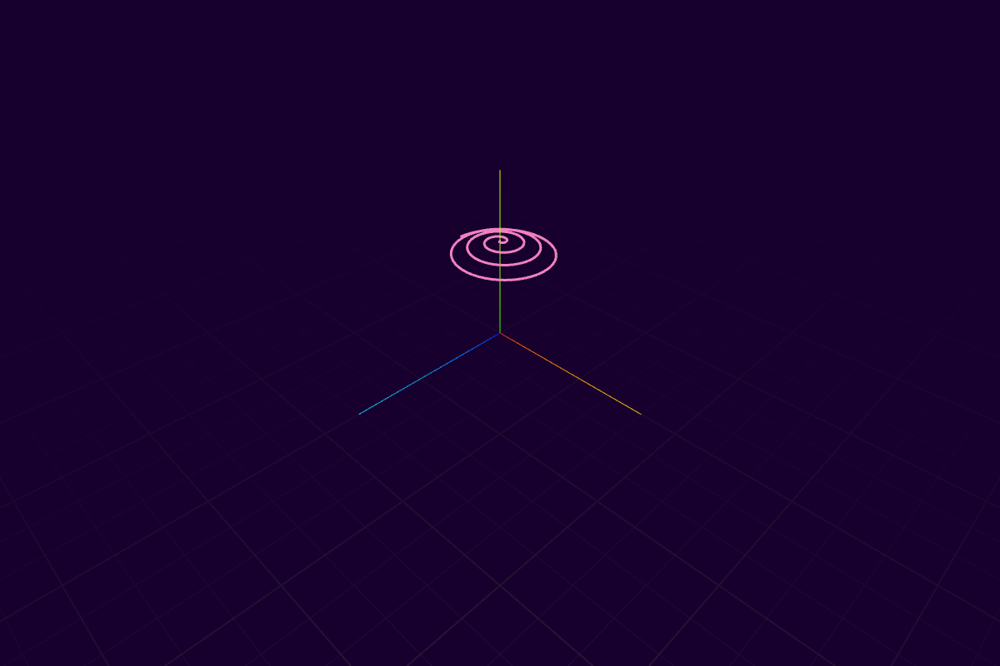

# Quaternion Spiral

A small creative-coding study: an animated path around a sphere, built with
**React, TypeScript, Three.js, and React Three Fiber**.



## What it demonstrates

- Compose a tilt and a spin using quaternion multiplication.
- Apply the rotation through custom `Vector3` and `Quaternion` classes.
- Draw the growing path in a Three.js scene with orbit and zoom controls.

The repository keeps its original name, `threejs-loxodrome`. The implemented path
is a spherical spiral produced by linearly changing tilt and spin; it is not a
constant-bearing navigational loxodrome. This is an educational visual experiment.

## Run locally

Requires Node.js 24 and a browser with WebGL.

```sh
npm ci
npm run dev
```

Open the local address printed by Vite. Drag to orbit; scroll to zoom. The path
builds progressively; reload to replay it.

```sh
npm run lint
npm run build
npm run preview
npm audit
```

## Explore the code

| File | Responsibility |
| --- | --- |
| `src/App.tsx` | Rotation composition, animation timing, and scene |
| `src/classes/Quaternion.ts` | Axis-angle conversion and quaternion operations |
| `src/classes/Vector3.ts` | Vector rotation |
| `src/Path.tsx` | Line rendering |
| `src/Points.tsx` | Optional instanced-point renderer |

Axis-angle conversion expects a unit axis; conjugation is used as the inverse
for unit quaternions. The current animation uses normalized coordinate axes.
It advances once per rendered frame, so playback duration depends on frame rate.
There is no backend, account system, or credential setup.

## Contributing and security

See [CONTRIBUTING.md](CONTRIBUTING.md) and [SECURITY.md](SECURITY.md).

## License

[MIT](LICENSE). Third-party dependencies retain their own licenses.
